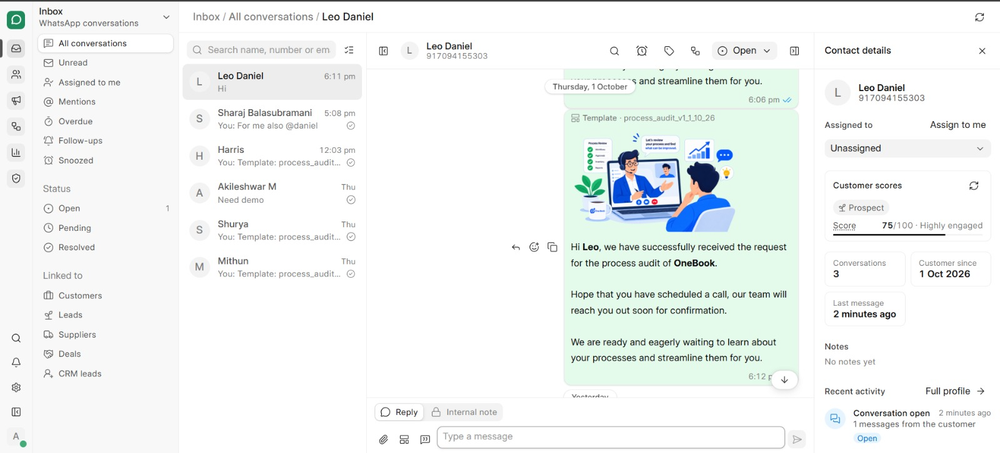

<div align="center" markdown="1">


<h1>OneChat</h1>

**Open source WhatsApp and Instagram inbox for teams, built on Frappe**

[](license.txt)

</div>

<div align="center">
	
</div>
<br />
<div align="center">
	<a href="https://github.com/OneBook-ERP/OneChat/issues">Issues</a>
	-
	<a href="CONTRIBUTING.md">Contributing</a>
</div>

## OneChat

OneChat brings your WhatsApp and Instagram chats into one shared inbox, connected to your ERPNext and Frappe CRM data. Your team replies together, runs campaigns and automations, and sees how it's doing, all from `/onechat`.

### Key Features

- **Shared Inbox**: Assign chats, add notes, @mention teammates, snooze and set reminders. Switch between WhatsApp, Instagram or all channels.

- **Instagram**: Reply to DMs, story replies and mentions. Turn post comments into DMs with keywords, reply in bulk, and hide spam automatically.

- **Customer Context**: See orders, invoices, CRM leads and deals beside every chat. Send payment links, share your catalog, and turn catalog orders into Sales Orders.

- **Campaigns and Automation**: Send templates and broadcasts to segments, and build chatbots and workflows in a visual flow builder, with no code.

- **Insights and Assistant**: Track response times, team performance and costs, and ask the AI Assistant about customers or to draft replies.

- **Languages**: Use OneChat in English, Hindi or Arabic.

### Under the Hood

- [**Frappe Framework**](https://github.com/frappe/frappe): A full-stack web application framework.

- [**Frappe UI**](https://github.com/frappe/frappe-ui): A Vue-based UI library, to provide a modern user interface.

- [**WhatsApp Cloud API**](https://developers.facebook.com/docs/whatsapp/cloud-api) and [**Instagram API**](https://developers.facebook.com/docs/instagram-platform/instagram-api-with-instagram-login): Meta's official APIs for business messaging.

## Production Setup

You need Frappe 15 or 16, and a Meta app with a WhatsApp Business account, an Instagram professional account, or both. ERPNext and Frappe CRM are optional.

**Step 1**: Get the app and install it on your site

```bash
cd ~/frappe-bench
bench get-app https://github.com/OneBook-ERP/OneChat --branch version-{latest}
bench --site <site> install-app onechat
bench --site <site> migrate
bench build --app onechat
bench restart
```

**Step 2**: Open `https://<your-site>/onechat`, go to **Settings** and:

| Step | Where |
| --- | --- |
| Add a WhatsApp number or connect Instagram | **Accounts** |
| Pick default WhatsApp accounts | **WhatsApp** |
| Choose how comments are handled | **Instagram** |
| Check everything is connected | **Health** |

**Note:** Instagram works for your own test users right away. Before customers can use it, Meta must approve your app for `instagram_business_basic`, `instagram_business_manage_messages` and `instagram_business_manage_comments` in App Review.

## Development Setup

1. Install bench and set up a `frappe-bench` directory by following the [Installation Steps](https://frappeframework.com/docs/user/en/installation).
1. Start the server:
	```sh
	bench start
	```
1. In a separate terminal window, run:
	```sh
	bench new-site onechat.test
	bench --site onechat.test add-to-hosts
	bench get-app https://github.com/OneBook-ERP/OneChat --branch develop
	bench --site onechat.test install-app onechat
	```
1. For the interface with live reload:
	```sh
	cd apps/onechat/frontend
	yarn install
	yarn dev
	```
1. Open `http://onechat.test:8000/onechat` in your browser.

## Learn more

- [Contributing](CONTRIBUTING.md)
- [Translations](docs/translations.md)
- [Report an issue](https://github.com/OneBook-ERP/OneChat/issues)

## License

[GNU Affero General Public License v3.0](license.txt) · Copyright (c) 2025–2026 OneBook
